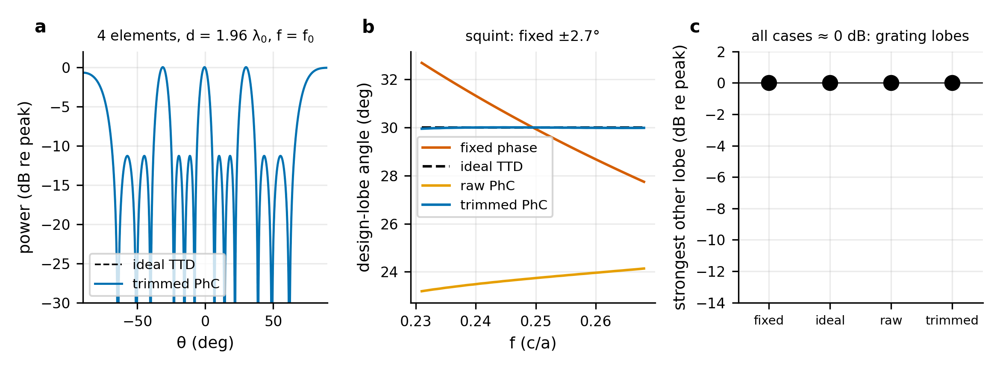
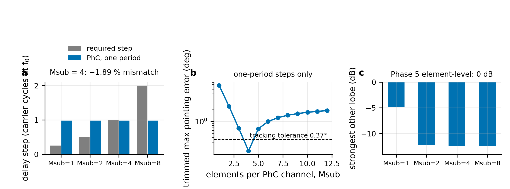

# pc-ttd-beamforming

**Computational electromagnetics study of W1 photonic-crystal delay lines for phased-array beamforming using MPB, MEEP/FDTD, complex transfer-function extraction, and array-level modeling.**

<p align="center">
  
</p>

## Overview

This project investigates whether a physically simulated W1 photonic-crystal (PhC) waveguide can provide useful true-time-delay behavior for wideband phased-array beamforming.

The study follows the full computational chain

$$
\text{Maxwell / FDTD}
\rightarrow H(f)
\rightarrow \phi(f)
\rightarrow \tau_g
\rightarrow \text{channel delays}
\rightarrow \text{array factor}
\rightarrow \theta(f),
$$

rather than assuming ideal delay elements at the array level.

The central result is a **negative-to-positive architecture case study**:

- At **element level**, the available W1 delay step is too coarse for $\lambda_0/2$ steering and forces a sparse effective array pitch with approximately 0 dB grating lobes.
- At **subarray level**, the same delay step is close to the required delay for four-element $\lambda_0/2$ subarrays near $30^\circ$, substantially reducing beam squint relative to fixed-phase steering.

This is a **2-D, lossless computational study**. It is not an experimental demonstration and does not claim a new true-time-delay architecture or new photonic-crystal physics.

---

## Key Results

For the selected plain W1 waveguide:

- validated normalized-frequency range: **0.231–0.268 $c/a$**
- fractional bandwidth: **14.8%**
- group index: approximately **3.9**
- one lattice period provides approximately **0.981 carrier cycle** of delay
- four directly simulated channels use lengths **$N=8,9,10,11$**

### Element-Level Result

For a four-element array steered to $30^\circ$:

- required delay at $\lambda_0/2$ spacing: approximately **0.25 cycle per element**
- available W1 delay increment: approximately **0.981 cycle**
- corresponding effective pitch: approximately **1.96 $\lambda_0$**
- result: grating lobes approximately as strong as the design lobe

The PhC channels reproduce the desired delay slope well after phase trimming, but the delay granularity is incompatible with element-level spatial sampling.

This is the principal negative result of the study: a delay line can exhibit good electromagnetic delay behavior while still being unsuitable for a particular phased-array architecture.

### Subarray-Level Result

The same W1 delay increment becomes useful when applied between four-element $\lambda_0/2$ subarrays.

At a nominal steering angle of $30^\circ$:

- required adjacent-subarray delay: **1.000 carrier cycle**
- available W1 delay: **0.981 carrier cycle**
- delay mismatch: approximately **−1.9%**
- exact analytic match angle: **29.377°**
- maximum PhC pointing error over the validated band: **0.189°**
- fixed-phase maximum pointing error: **2.69°**
- squint ratio: **$R_{\mathrm{squint}}=0.070$**
- strongest ordinary sidelobe: approximately **−12.4 dB**
- strongest subarray replica lobe: approximately **−16.6 dB**

The useful angular range is narrow. Under the stricter post hoc criteria, the principal useful window is approximately

$$
26^\circ \leq \theta_0 \leq 34^\circ.
$$

<p align="center">
  
</p>

---

## What the Project Demonstrates

The main engineering lesson is that **delay-line performance cannot be evaluated independently of array geometry**.

A delay increment can be

- physically well behaved,
- accurately modeled,
- nearly linear in phase versus frequency,

and still be unusable at the element level because its minimum delay step is incompatible with the required spatial sampling.

The same physical delay increment can become useful when it is applied at a different hierarchy level in the array.

For half-wave-spaced antenna elements, the required adjacent-subarray delay in carrier cycles is

$$
q_{\mathrm{req}}
=
\frac{M_{\mathrm{sub}}\sin\theta_0}{2},
$$

while a $k$-period W1 increment provides

$$
q_{\mathrm{PhC}}
=
k f_0 \tau_{\mathrm{PhC}}.
$$

The matching condition is therefore

$$
\frac{M_{\mathrm{sub}}\sin\theta_{\mathrm{match}}}{2}
=
k f_0 \tau_{\mathrm{PhC}}.
$$

This relation follows from standard phased-array theory. The contribution of this computational study is to examine the consequences of that relationship using complex transfer functions extracted from a verified full-wave W1 model rather than assuming ideal delay elements.

---

## Numerical Workflow

The project uses a verification-first computational workflow.

### 1. Electromagnetic Verification

Before using the W1 structure as a delay element, the numerical workflow is checked against simpler electromagnetic references.

Verification includes:

- vacuum propagation
- homogeneous dielectric propagation
- quarter-wave Bragg stack versus transfer-matrix theory
- finite photonic-crystal stop bands versus MPB band structure
- W1 group delay versus MPB group index
- time-domain pulse propagation versus phase-derived delay
- resolution and domain-sensitivity studies

These tests establish the numerical conventions used later in the delay-line and array calculations.

### 2. W1 Delay-Line Modeling

The selected device is a W1 line defect in a triangular lattice of air holes in a dielectric with

$$
\epsilon_r=12.
$$

The study uses TE polarization.

**MPB** is used for:

- photonic band structure
- guided-mode identification
- group index
- frequency-window selection

**MEEP/FDTD** is used for:

- finite-device propagation
- modal transmission
- complex transfer-function extraction
- convergence and domain studies

The Phase 3 trade study compares a plain W1 geometry with two first-row modifications.

Within the FDTD-validated frequency range, the plain W1 provides a group index of approximately 3.9 across the full 14.8% domain-limited bandwidth. The modified geometries increase group index by approximately 7–14%, but reduce the corresponding $\pm10\%$ group-index bandwidth to approximately 8.4% and 5.6%.

The plain W1 is therefore retained for the final channel family.

### 3. Complex Transfer-Function Extraction

For each simulated channel,

$$
H_m(f)
=
|H_m(f)|e^{i\phi_m(f)}
$$

is extracted from the projected guided mode.

Using the time convention

$$
e^{-i\omega t},
$$

a positive propagation delay corresponds to

$$
e^{+i\omega\tau}.
$$

The group delay is obtained from the phase slope,

$$
\tau_g
=
\frac{d\phi}{d\omega}.
$$

Four channels with lengths

$$
N=8,9,10,11
$$

are simulated directly.

Across the validated band:

- adjacent fitted delay increments reproduce the target delay step to better than approximately **0.2%**
- amplitude imbalance is no greater than approximately **0.023 dB**
- transmission is at least approximately **0.997**
- the raw channels contain a large frequency-independent phase-intercept error
- one constant phase trim per channel reduces the residual phase error to approximately **0.026 rad or less**

The phase trim changes the phase intercept but not the phase slope, and therefore does not alter the group delay.

### 4. Array-Level Modeling

The simulated complex channel responses are propagated directly into the array model as frequency-dependent weights.

The array analysis evaluates:

- beam pointing
- beam squint
- peak power
- half-power beamwidth
- sidelobes
- grating lobes
- subarray replica lobes
- phase perturbations
- delay perturbations
- amplitude perturbations
- system-level Monte Carlo robustness

This allows the electromagnetic delay-line model and the phased-array model to remain connected through the actual simulated transfer functions.

---

## Element-Level Limitation

At the design angle of $30^\circ$, a half-wave-spaced element array requires an adjacent-element true-time-delay increment of approximately one quarter of a carrier cycle.

The simulated W1 structure instead provides approximately one carrier cycle per lattice-period increment.

Using that delay directly between individual antenna elements requires an effective spacing of approximately

$$
d \approx 1.96\lambda_0.
$$

Although the frequency-dependent pointing behavior closely follows ideal true-time delay after phase trimming, this sparse spacing produces grating lobes as strong as the intended beam.

The element-level architecture is therefore rejected.

<p align="center">
  
</p>

---

## Subarray Mitigation

The delay-granularity problem is mitigated by applying the W1 delay between subarrays rather than between individual antenna elements.

For a four-element subarray,

$$
M_{\mathrm{sub}}=4,
$$

the required delay near $30^\circ$ is approximately one carrier cycle, which closely matches the simulated one-period W1 delay.

This changes the role of the PhC device:

- conventional phase relationships are retained within each half-wave-spaced subarray
- the PhC delay is applied between subarrays
- the coarse delay step is therefore matched to a larger spatial interval

The resulting architecture avoids the approximately 0 dB element-level grating-lobe failure while retaining much of the beam-squint reduction associated with true-time-delay steering.

<p align="center">
  
</p>

---

## Robustness

The final architecture is evaluated under perturbations to:

- phase
- delay
- amplitude

as well as combined Monte Carlo perturbations.

For the selected $M_{\mathrm{sub}}=4$ configuration, the combined system-level Monte Carlo analysis gives a **95th-percentile pointing error of approximately 0.35°** under the modeled perturbation assumptions.

The robustness analysis is computational and does not substitute for a fabrication-tolerance or experimental uncertainty study.

See:

- [`docs/phase6_report.md`](docs/phase6_report.md)
- [`docs/phase6_report_tables.md`](docs/phase6_report_tables.md)

---

## Conventional Propagation Reference

A propagation-length comparison was added to place the W1 delay in context.

For one carrier cycle of delay at the design frequency:

| Medium | Group index | Required length |
|---|---:|---:|
| Air | 1.000 | $1.000\,\lambda_0$ |
| Ideal homogeneous $\epsilon_r=12$ dielectric | 3.464 | $0.2887\,\lambda_0$ |
| Selected W1 | 3.932 | $0.2543\,\lambda_0$ |

The selected W1 is therefore only approximately **11.9% shorter** than the ideal homogeneous high-index propagation reference.

This is a length-only comparison. It does not include:

- waveguide width
- cladding
- bends
- couplers
- propagation loss
- fabrication constraints
- system integration

The project therefore does **not** claim a large general footprint advantage over conventional high-index propagation.

---

## Verification and Reproducibility

The current test suite contains **211 passing tests**.

The code includes analytic, numerical, and regression checks covering:

- homogeneous propagation
- Fresnel behavior
- transfer-matrix comparisons
- FDTD convergence
- MPB/FDTD consistency
- modal transfer-function extraction
- phase and delay conventions
- array-factor calculations
- final-result reproducibility

The production environment is recorded in:

- `environment/environment.yml`
- `environment/env_versions.json`

Primary environment:

- Python 3.10
- MEEP 1.33.0-beta
- MPB through `meep.mpb`
- NumPy 1.24.3
- SciPy 1.11.1
- Matplotlib 3.10.6
- pandas 2.0.3
- pytest 7.4.0

To run the test suite:

```bash
PY=~/miniconda3/envs/MEEP-GPU/bin/python
cd ~/MEEP/pc-ttd-beamforming
$PY -m pytest -q
```

Detailed reproduction instructions are provided in:

[`docs/reproducibility.md`](docs/reproducibility.md)

---

## Reproducing the Main Computational Stages

The full project was developed in sequential verification and modeling stages. The principal scripts are retained so that intermediate results can be reproduced independently.

### Phase 1 — FDTD Verification

```bash
PY=~/miniconda3/envs/MEEP-GPU/bin/python

$PY -m pytest

cd experiments/phase1

$PY 1a_vacuum.py
$PY 1b_dielectric.py
$PY 1d_mpb_directional.py
$PY 1c_bragg.py
$PY 1d_pc2d.py
$PY 1d_attenuation.py
$PY 1d_termination.py
$PY 1d_edges.py
$PY report.py
$PY make_figures.py
```

Methods and derivations:

[`docs/phase1_methods.md`](docs/phase1_methods.md)

### Phase 3 — W1 Trade Study

```bash
PY=~/miniconda3/envs/MEEP-GPU/bin/python

cd experiments/phase3

$PY 3a_mpb_designs.py
$PY 3c_mpb_res.py
$PY 3d_mpb_analyze.py

for d in "D0 1.0 0.0" "D1 1.2 -0.05" "D2 1.2 -0.10"; do
    set -- $d
    $PY 3b_fdtd.py $1 30 $2 $3 4 8 12 &
done
wait

for d in D0 D1 D2; do
    $PY 3e_analyze.py $d 30
    $PY 3e_analyze.py $d 40
done

$PY 3g_tables.py
$PY 3f_figures.py
```

### Phase 4 — Four-Channel Delay Family

```bash
PY=~/miniconda3/envs/MEEP-GPU/bin/python

cd experiments/phase4

$PY 4a_fdtd.py 30 --min_after=3500 &
$PY 4a_fdtd.py 40 --min_after=3500 &
wait

$PY 4b_analyze.py 30
$PY 4b_analyze.py 40
$PY 4c_resolution_handoff.py --handoff
$PY 4e_tables.py
$PY 4d_figures.py
```

### Phase 5 — Element-Level Array

```bash
PY=~/miniconda3/envs/MEEP-GPU/bin/python

cd experiments/phase5

$PY 5a_array.py
$PY 5b_figures.py
$PY 5c_tables.py
$PY 5d_handoff.py
```

### Phase 6 — Subarray Mitigation and Robustness

The Phase 6 workflow is

```text
6a_subarrays.py
    ↓
6b_robustness.py
    ↓
6c_figures.py
    ↓
6d_tables.py
    ↓
6e_handoff.py
```

The robustness calculation uses a fixed Monte Carlo seed for reproducibility.

### Phase 7 — Final Synthesis

Phase 7 performs final synthesis from existing results and does not introduce a new electromagnetic simulation campaign.

```bash
PY=~/miniconda3/envs/MEEP-GPU/bin/python

cd experiments/phase7

$PY 7a_final_results.py
$PY 7b_figures.py
$PY 7c_tables.py
$PY 7d_handoff.py
```

The later analytic additions include:

```text
7e_angle_sweep.py
7f_conventional_reference.py
```

These use the validated simulation results and do not require new FDTD runs.

---

## Repository Structure

```text
src/pcttd/
    reusable geometry, band-structure, transfer-function,
    delay, and array-analysis code

experiments/
    numbered simulation and analysis scripts organized
    by project phase

tests/
    analytic, numerical, regression, and reproducibility tests

results/
    machine-readable simulation and analysis outputs

figures/
    figures regenerated from stored results

docs/
    research plan, methods, phase reports, final report,
    manuscript draft, and reproducibility documentation

environment/
    conda environment specification and recorded package versions
```

---

## Selected Documentation

For a concise project overview:

- [`docs/executive_summary.md`](docs/executive_summary.md)
- [`docs/final_report.md`](docs/final_report.md)

For the manuscript-style research narrative:

- [`docs/manuscript_draft.md`](docs/manuscript_draft.md)

For numerical methods and verification:

- [`docs/phase1_methods.md`](docs/phase1_methods.md)
- [`docs/reproducibility.md`](docs/reproducibility.md)

For final numerical values:

- [`docs/final_tables.md`](docs/final_tables.md)

For the individual computational stages:

- [`docs/phase1_report.md`](docs/phase1_report.md)
- [`docs/phase2_report.md`](docs/phase2_report.md)
- [`docs/phase3_report.md`](docs/phase3_report.md)
- [`docs/phase4_report.md`](docs/phase4_report.md)
- [`docs/phase5_report.md`](docs/phase5_report.md)
- [`docs/phase6_report.md`](docs/phase6_report.md)

---

## Data Integrity

Machine-readable results are retained under `results/`.

Figures and final tables are generated from stored computational results rather than manually reconstructed values wherever the project workflow permits.

The repository preserves intermediate phase outputs so that the progression from electromagnetic verification to system-level conclusions can be audited.

Planned calculations that were not executed are distinguished from completed simulation results in the project documentation.

---

## Limitations

The principal limitations of the present study are:

- 2-D electromagnetic model
- lossless dielectric
- non-dispersive material model
- no fabrication disorder
- no out-of-plane radiation
- no bends
- no input/output couplers
- no channel-to-channel electromagnetic coupling
- no thermal effects
- isotropic antenna-element model
- no antenna mutual coupling
- four directly simulated delay channels
- one simulated adjacent-channel delay increment
- one constant phase trim per channel
- angle sweep reuses the same validated channel family
- narrow useful steering-angle range
- validated normalized-frequency range limited to 0.231–0.268
- no experimental validation

The results should therefore be interpreted as a **verified computational case study**, not as a demonstration of deployable photonic beamforming hardware.

---

## Project Status

The principal computational investigation is complete.

The repository contains:

- MPB band-structure calculations
- verified MEEP/FDTD modeling
- W1 delay-bandwidth trade study
- directly simulated four-channel delay family
- complex transfer-function extraction
- element-level negative result
- subarray-level mitigation
- perturbation and Monte Carlo robustness analysis
- steering-angle sweep
- conventional propagation reference
- final synthesis
- manuscript draft
- reproducibility documentation

Potential extensions would require a new scope, such as 3-D slab modeling, realistic material loss, disorder, bends, couplers, additional delay increments, full photonic routing, antenna coupling, or experimental validation.

---

## License

This project is distributed under the terms provided in the repository's [`LICENSE`](LICENSE) file.