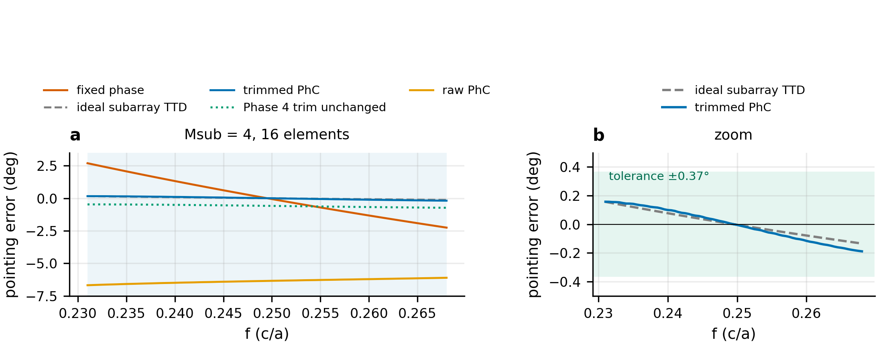
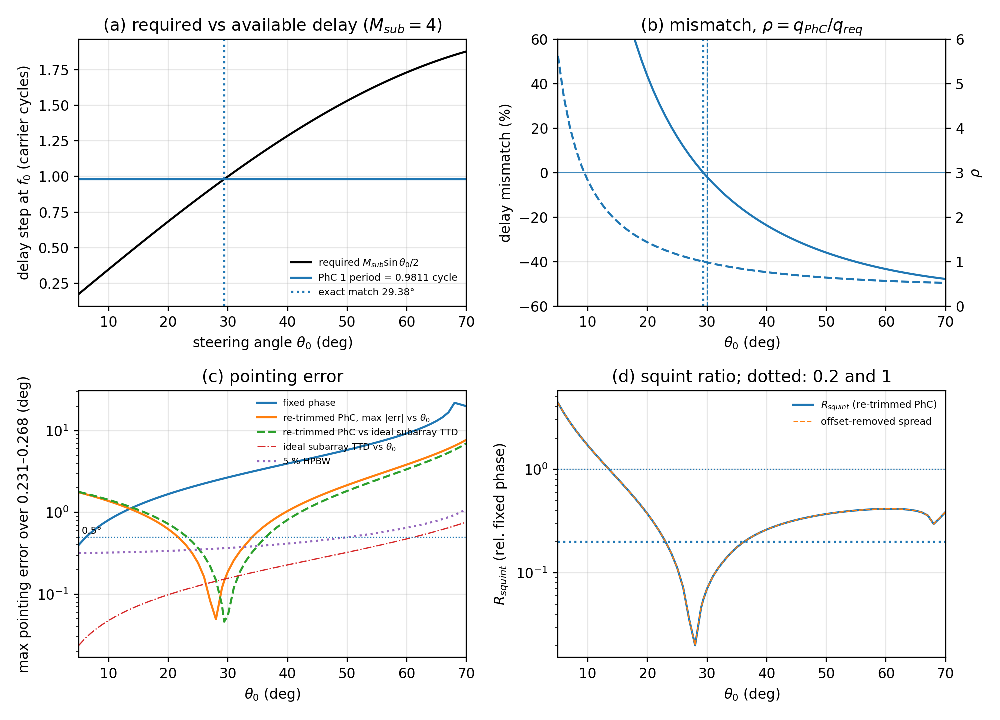

# pc-ttd-beamforming

Computational study of W1 photonic-crystal delay lines for phased-array beamforming using MPB, MEEP/FDTD, modal transfer-function extraction, and array-factor analysis.

<p align="center">
  
</p>

## Problem studied

The calculation starts with a finite W1 photonic-crystal waveguide and carries its simulated complex transfer function into a phased-array model,

$$
\text{FDTD} \rightarrow H(f) \rightarrow \phi(f) \rightarrow \tau_g
\rightarrow \text{channel weights} \rightarrow \text{array factor}.
$$

The selected device is a TE W1 line defect in a triangular lattice of air holes in a lossless dielectric with $\epsilon_r=12$ and $r/a=0.30$. MPB supplies the band structure and modal group index; MEEP/FDTD supplies finite-device propagation and modal transmission.

The study produced both a negative and a useful result. A one-period W1 length increment gives about 0.981 carrier cycle of delay near the design frequency. That increment is too large for element-by-element steering at $\lambda_0/2$ spacing, but it is close to the delay required between four-element $\lambda_0/2$ subarrays near $30^\circ$.

## Main numerical results

For the plain W1 used in the final channel family:

- validated frequency range: **0.231–0.268 $c/a$** (**14.8%** fractional bandwidth)
- group index: approximately **3.9**
- simulated channel lengths: **$N=8,9,10,11$** periods
- fitted adjacent-channel delay increment: about **3.931 $a/c$**, or **0.981 carrier cycle** at band center
- maximum amplitude imbalance: about **0.023 dB**
- one constant phase trim per channel reduces residual phase error to about **0.026 rad**

At element level, the delay step corresponds to an effective spacing of about **1.96 $\lambda_0$** at $30^\circ$. The resulting array has grating lobes at approximately 0 dB even though the frequency-dependent pointing tracks ideal TTD closely after trimming. This architecture was therefore rejected.

For four-element subarrays, the required inter-subarray delay at $30^\circ$ is 1.000 carrier cycle. The simulated W1 step is 0.981 cycle, a mismatch of about **−1.9%**. In the 16-element subarray example:

- exact analytic delay-match angle: **29.377°**
- maximum pointing error over the validated band: **0.189°**
- fixed-phase maximum pointing error: **2.69°**
- $R_{\mathrm{squint}}$: **0.070**
- strongest ordinary sidelobe: about **−12.4 dB**
- strongest subarray replica lobe: about **−16.6 dB**

The angle sweep shows that this is a narrow operating region rather than a broadly scannable solution. Under the stricter post hoc criteria used in the sweep, the useful region is approximately **26°–34°**.

<p align="center">
  
</p>

## Verification

The numerical workflow was checked before the array calculation. The repository includes:

- vacuum and homogeneous-dielectric propagation checks
- quarter-wave Bragg stack comparison with transfer-matrix theory
- finite photonic-crystal stop-band comparison with MPB
- W1 FDTD group delay compared with MPB group index
- time-domain pulse delay compared with phase-derived delay
- resolution, domain-size, termination, and sampling studies

The production calculations use resolution 30 px/$a$ with resolution 40 as a confirmation case. The Phase 2–4 FDTD calculations use a DFT decay tolerance of $10^{-7}$ after looser stopping criteria were found to add substantial derivative noise.

## Delay-bandwidth trade study

Three W1 variants were examined before the channel family was fixed. The first-row modifications increased delay but reduced the usable bandwidth and increased dispersion:

| design | flat-delay band | fractional BW | median delay/period | GDD/period |
|---|---|---:|---:|---:|
| D0 plain W1 | 0.231–0.268 | 14.8% | 3.93 $a/c$ | −0.91 $(a/c)^2$ |
| D1 | 0.2465–0.268 | 8.4% | 4.20 $a/c$ | −3.86 $(a/c)^2$ |
| D2 | 0.2535–0.268 | 5.6% | 4.47 $a/c$ | −7.07 $(a/c)^2$ |

The plain W1 (D0) was retained. The final device is therefore not a dispersion-engineered W1.

## Conventional propagation reference

For one carrier cycle of delay at the design frequency:

| medium | group index | length |
|---|---:|---:|
| air | 1.000 | $1.000\,\lambda_0$ |
| ideal homogeneous $\epsilon_r=12$ | 3.464 | $0.2887\,\lambda_0$ |
| selected W1 | 3.932 | $0.2543\,\lambda_0$ |

The W1 is about **11.9% shorter** than the ideal homogeneous high-index reference. This is only a propagation-length comparison; it does not include bends, couplers, waveguide width, loss, fabrication, or system integration.

## Repository layout

```text
src/pcttd/       reusable geometry, band, FDTD-analysis, delay, and array code
experiments/     numbered simulation and analysis scripts by project phase
tests/           analytic, numerical, regression, and reproducibility tests
results/         stored numerical outputs
figures/         figures generated from stored results
docs/            methods, phase reports, final report, manuscript, and tables
environment/     recorded conda environment and package versions
```

The most useful documents are:

- [`docs/final_report.md`](docs/final_report.md) — complete project report
- [`docs/manuscript_draft.md`](docs/manuscript_draft.md) — manuscript-style presentation
- [`docs/phase1_methods.md`](docs/phase1_methods.md) — numerical methods and verification details
- [`docs/final_tables.md`](docs/final_tables.md) — final numerical values and definitions
- [`docs/reproducibility.md`](docs/reproducibility.md) — commands and environment details
- [`docs/decisions.md`](docs/decisions.md) — recorded modeling and analysis decisions

## Reproduction

The recorded environment uses Python 3.10, MEEP 1.33.0-beta, MPB through `meep.mpb`, NumPy 1.24.3, SciPy 1.11.1, Matplotlib 3.10.6, pandas 2.0.3, and pytest 7.4.0.

```bash
PY=~/miniconda3/envs/MEEP-GPU/bin/python
$PY -m pytest -q
```

The final plots and tables can be regenerated from stored results without rerunning FDTD:

```bash
cd experiments/phase7
$PY 7a_final_results.py
$PY 7b_figures.py
$PY 7c_tables.py
$PY 7d_handoff.py
$PY 7e_angle_sweep.py
$PY 7f_conventional_reference.py
```

The earlier phase scripts are retained under `experiments/` for reproducing the underlying electromagnetic calculations. Full commands and the expected runtime hierarchy are in [`docs/reproducibility.md`](docs/reproducibility.md).

## Limitations

The results are limited to a 2-D, lossless, non-dispersive dielectric model. The study does not include out-of-plane radiation, fabrication disorder, propagation loss, bends, couplers, thermal effects, electromagnetic coupling between channels, realistic antenna element patterns, mutual coupling, or experiment. Only four channel lengths and one simulated adjacent-channel delay increment were used. The angle sweep reuses the same channel family, and the phase trim is reset for each steering angle. The validated frequency interval is 0.231–0.268 $c/a$.

The repository therefore reports a computational result about delay granularity and array hierarchy, not a deployable photonic beamformer or a general footprint advantage over conventional delay lines.

## License

MIT. See [`LICENSE`](LICENSE).
